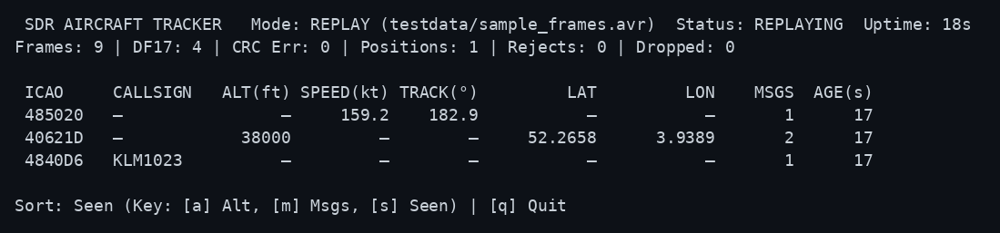

# SDR Aircraft Tracker

Mode S DF17 decoding, aircraft state tracking, and a terminal dashboard in Go.

[](https://github.com/khalid7344/sdr-aircraft-tracker/actions/workflows/ci.yml)
[](go.mod)
[](LICENSE)



Bundled AVR reference-frame replay.

## Overview and architecture

The Go process consumes ASCII AVR frames from a file or TCP upstream. RF sampling,
PPM demodulation, and IQ processing belong to an external front end such as dump1090.

```text
AVR file / dump1090 TCP :30002
  -> ingest (framing, queue, reconnect)
  -> adsb (CRC-24, DF17 fields, global CPR)
  -> tracker (ICAO state, pairing, TTL, plausibility checks)
  -> tui (snapshot polling) / headless JSON summary
```

`cmd/sdr-tracker` wires the CLI and lifecycle. `internal/ingest`, `internal/adsb`,
`internal/tracker`, and `internal/tui` separate transport, protocol, state, and display.

## Algorithmic core

### Mode S CRC-24 parity

An Extended Squitter frame contains 88 payload bits and 24 parity bits. The Mode S
generator polynomial is written below with ASCII exponents:

```text
G(x) = x^24 + x^23 + x^22 + x^21 + x^20 + x^19 + x^18 + x^17
     + x^16 + x^15 + x^14 + x^13 + x^12 + x^10 + x^3 + 1
```

Its lower 24 coefficients are `0xFFF409`; the leading `x^24` term is implicit in
that notation. The full 25-bit polynomial is `0x1FFF409`. Division uses `GF(2)`:
addition and subtraction are XOR. A valid DF17 frame has a zero CRC remainder.

### Compact Position Reporting (CPR)

CPR encodes latitude and longitude as 17-bit integers. With `N_z = 15`, there are
60 even latitude zones and 59 odd zones. The tracker needs an even/odd pair received
at most 10 seconds apart; the more recent frame determines the final position.

Let `Y_even`, `Y_odd`, `X_even` and `X_odd` be encoded latitude/longitude values
divided by `131072` (2^17). `mod` below is nonnegative modulo, and `floor` rounds
downward:

```text
j = floor(59 * Y_even - 60 * Y_odd + 0.5)
lat_even = (360 / 60) * (mod(j, 60) + Y_even)
lat_odd  = (360 / 59) * (mod(j, 59) + Y_odd)
```

Latitudes at least 270 degrees are reduced by 360 degrees to recover southern
coordinates; results outside -90..90 degrees are rejected. Both frames must have
matching longitude-zone counts: `NL(lat_even) == NL(lat_odd)`.

```text
NL = NL(lat_even)  # equal to NL(lat_odd) for an accepted pair
m = floor(X_even * (NL - 1) - X_odd * NL + 0.5)
```

Longitude uses `360 / max(NL - parity, 1)` degrees per zone, with `parity = 0` for
even or `1` for odd, and the corresponding `X` value. The result is normalized to
-180..180 degrees. The tracker applies coordinate, altitude, speed and movement
plausibility checks before accepting updates.
## Installation and quick start

### Linux amd64 release

Download [v1.0.1](https://github.com/khalid7344/sdr-aircraft-tracker/releases/tag/v1.0.1), verify the archive, then extract:

```sh
curl -fLO https://github.com/khalid7344/sdr-aircraft-tracker/releases/download/v1.0.1/sdr-aircraft-tracker_v1.0.1_linux_amd64.tar.gz
curl -fLO https://github.com/khalid7344/sdr-aircraft-tracker/releases/download/v1.0.1/SHA256SUMS
sha256sum -c SHA256SUMS
tar -xzf sdr-aircraft-tracker_v1.0.1_linux_amd64.tar.gz
cd sdr-aircraft-tracker_v1.0.1_linux_amd64
./sdr-tracker --version
```

### Build from source

Requires Go 1.22+ and Git. Race tests also require a C compiler. The TUI requires
an interactive terminal; the report commands below work in scripts.

```sh
git clone https://github.com/khalid7344/sdr-aircraft-tracker.git
cd sdr-aircraft-tracker
CGO_ENABLED=0 go build -trimpath -buildvcs=false -o bin/sdr-tracker ./cmd/sdr-tracker
```

For repeatable binaries, use the same source commit, Go version, GOOS, and GOARCH.
Dependencies are pinned in `go.mod` and `go.sum`; verify them with `go mod verify`.

## Offline demonstration

From the cloned source directory after building:

```sh
./bin/sdr-tracker --mode=replay --replay-file=testdata/sample_frames.avr --replay-interval=50ms
# Noninteractive summary:
./bin/sdr-tracker --mode=replay --replay-file=testdata/sample_frames.avr --replay-interval=0 --headless
```

## Usage

For a configured dump1090 upstream:

```sh
./bin/sdr-tracker --mode=tcp --addr=127.0.0.1:30002
```

Keys: `a` sorts by altitude, `m` by message count, `s` by last seen, `q` quits.
`--ttl` controls eviction; `--log-file` writes JSON lifecycle events. Use `--help`
for all flags. Replay arrival times determine CPR pairing timestamps.

## Testing and benchmarks

```sh
go vet ./...
go test -v -race ./...
go test -run '^$' -bench=. -benchmem ./...
```

Local sample: Linux amd64, AMD Ryzen 7 7700, Go 1.27.3,
`-benchtime=100ms`, captured during this update. CRC24: 5.931 ns/op, 0 B/op, 0 allocs/op; global CPR: 67.19 ns/op,
0 B/op, 0 allocs/op.

Benchmark results depend on the host and Go toolchain. Run the command above
to measure the current checkout; microbenchmarks do not measure live end-to-end overhead.

## Scope and limitations

Reference-frame replay and automated tests validate decoding and state handling.
Live RTL-SDR reception has not been tested. Global airborne CPR requires an even/odd
pair within 10 seconds. Local CPR, surface positions, MLAT, and IQ/DSP processing
are outside the current implementation. TCP overload may drop queued frames;
replay uses blocking delivery. JSON logs record lifecycle events, not aircraft history.

## License

MIT. See [LICENSE](LICENSE). Third-party dependencies retain their own licenses.
